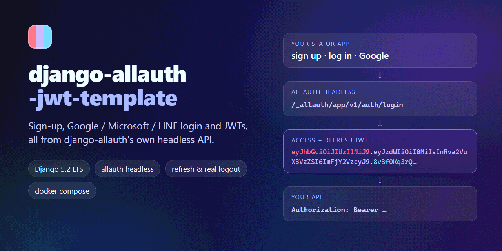
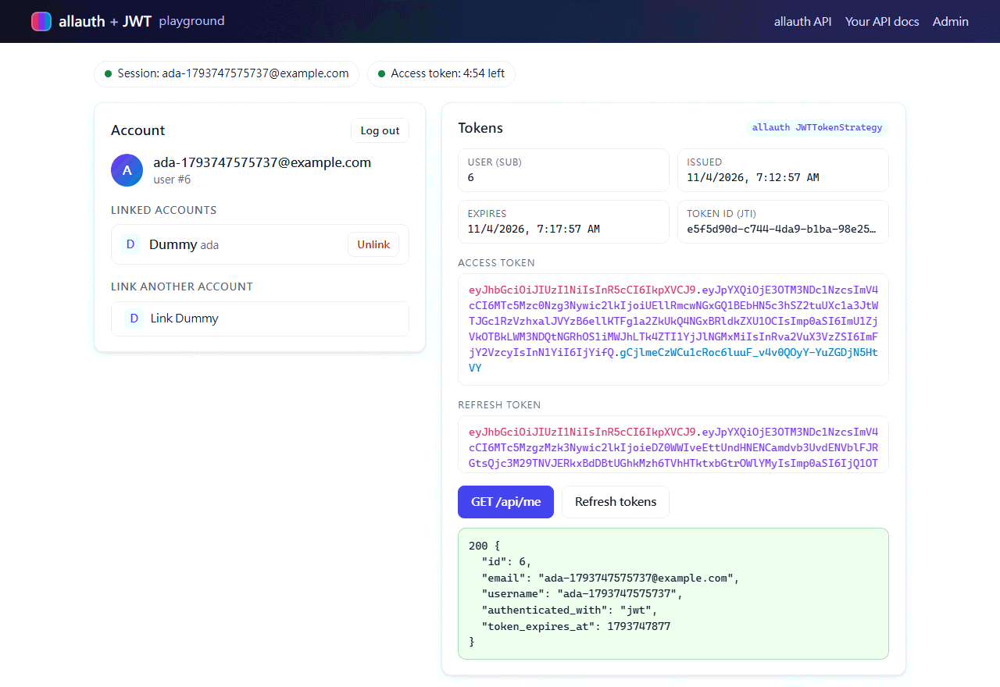
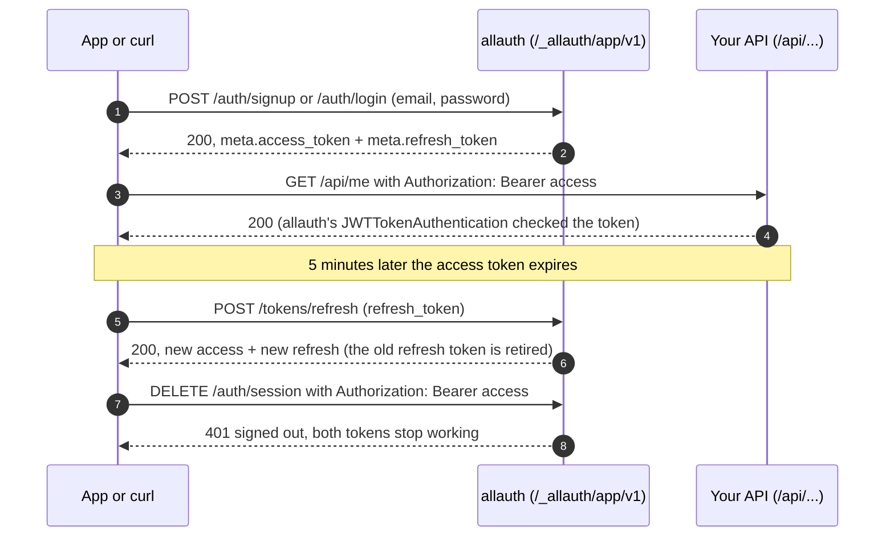
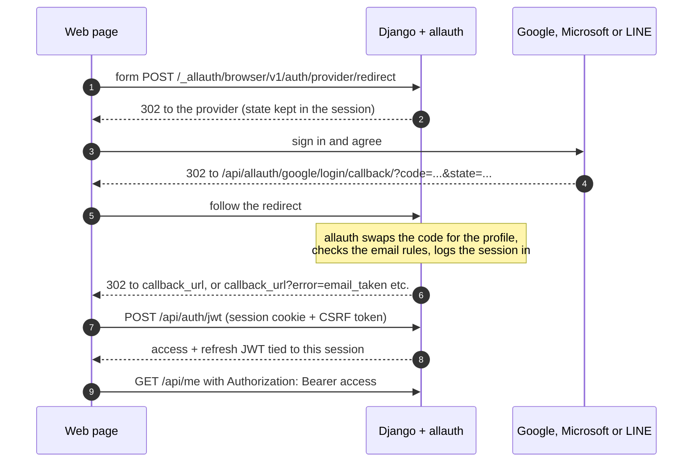

<p align="center">
  
</p>

<p align="center">
  <a href="https://github.com/NatLee/django-allauth-jwt-template/actions/workflows/ci.yml"></a>
  
  
  
</p>

# django-allauth-jwt-template

A Django starting point where [django-allauth](https://docs.allauth.org/) does all the
account work and hands your frontend a **JWT**. People sign up with email and password or
log in with **Google, Microsoft or LINE**; allauth's own JSON API (its *headless* mode)
runs those flows and issues an access/refresh token pair with its built-in JWT support.
Your API checks `Authorization: Bearer <token>`, refresh tokens rotate, and logging out
really ends the tokens. There is no hand-written OAuth or token code to maintain, and a
small demo page plus a curl script show every step.

<p align="center">
  
</p>

## Contents

- [This or django-simple-3rd-party-jwt?](#this-or-django-simple-3rd-party-jwt)
- [Quick start](#quick-start)
- [How it works](#how-it-works)
- [Endpoints](#endpoints)
- [Third-party login](#third-party-login)
- [Configuration](#configuration)
- [Build on it](#build-on-it)
- [Coming from the old version of this template](#coming-from-the-old-version-of-this-template)
- [Development](#development)

## This or django-simple-3rd-party-jwt?

Both give a frontend a JWT after a Google or Microsoft login.

- **[django-simple-3rd-party-jwt](https://github.com/NatLee/django-simple-3rd-party-jwt)** is a
  small app you `pip install` into an existing project: Google and Microsoft only, no
  passwords, Simple JWT tokens. Pick it when "sign in with Google/Microsoft, get a JWT" is all
  you need.
- **This template** is a whole project built on django-allauth: email and password sign-up,
  email confirmation, password reset, account linking, Google, Microsoft and LINE (allauth knows
  [over a hundred providers](https://docs.allauth.org/en/latest/socialaccount/providers/index.html)),
  refresh-token rotation and logout that revokes. Pick it when you start a project and want
  real account management.

## Quick start

You need Docker. Everything else runs in the container.

```bash
git clone https://github.com/NatLee/django-allauth-jwt-template.git
cd django-allauth-jwt-template
cp .env.example .env
docker compose up --build
```

Open <http://localhost:5566>. Create an account, call the API with the token, refresh it,
link the **Dummy** provider (a fake one for local testing, so you need no Google keys yet),
and log out. Emails, such as the confirmation link, are printed in the `docker compose` log.

In a second terminal, walk the same lifecycle with nothing but curl:

```bash
bash examples/walkthrough.sh
```

```text
1. Sign up as ada@example.com
  POST   /_allauth/app/v1/auth/signup                   -> 200
  access token:  eyJhbGciOiJIUzI1NiIsInR5…
  refresh token: eyJhbGciOiJIUzI1NiIsInR5…

2. Call your API with the access token
  GET    /api/me                                        -> 200
  {"id":8,"email":"ada@example.com","username":"ada","authenticated_with":"jwt","token_expires_at":1793747953}
  GET    /api/me                                        -> 401
  (no token, no entry)

3. Refresh: a new access token and a new refresh token
  POST   /_allauth/app/v1/tokens/refresh                -> 200
  new access token:  eyJhbGciOiJIUzI1NiIsInR5…
  POST   /_allauth/app/v1/tokens/refresh                -> 400
  (the old refresh token works only once)

4. Log out with the access token
  DELETE /_allauth/app/v1/auth/session                  -> 401
  (401 here means: you are signed out now)
  GET    /api/me                                        -> 401
  POST   /_allauth/app/v1/tokens/refresh                -> 400
  (both tokens of that session are dead)

5. Log in again with the password
  POST   /_allauth/app/v1/auth/login                    -> 200
  GET    /api/me                                        -> 200
  DELETE /_allauth/app/v1/auth/session                  -> 401

Every step behaved as expected.
```

A single call looks like this (tokens shortened):

```bash
curl -s -X POST http://localhost:5566/_allauth/app/v1/auth/login \
  -H 'Content-Type: application/json' \
  -d '{"email": "ada@example.com", "password": "correct-horse-battery-staple"}'
```

```json
{"status": 200,
 "data": {"user": {"id": 8, "display": "ada", "email": "ada@example.com", "has_usable_password": true, "username": "ada"},
          "methods": [{"method": "password", "at": 1793747661.151227, "email": "ada@example.com"}]},
 "meta": {"is_authenticated": true,
          "session_token": "xwt2etiwtfejg8pntukuvlfj2c4b4z2x",
          "access_token": "eyJhbGciOiJIUzI1NiIsInR5cCI6IkpXVCJ9.eyJpYXQiOjE3OTM3…",
          "refresh_token": "eyJhbGciOiJIUzI1NiIsInR5cCI6IkpXVCJ9.eyJpYXQiOjE3OTM3…"}}
```

To use the Django admin, make yourself a superuser:

```bash
docker compose exec api python manage.py createsuperuser
```

<details>
<summary>Without Docker (Python 3.12 or newer)</summary>

```bash
cp .env.example .env
cd backend
python -m venv .venv && . .venv/bin/activate   # Windows: .venv\Scripts\activate
pip install -r requirements-dev.txt
python manage.py migrate
python manage.py runserver 5566
```

`manage.py` reads the `.env` next to `.env.example`.
</details>

## How it works

allauth's [headless mode](https://docs.allauth.org/en/latest/headless/index.html) is a JSON
API with two flavours. **App** endpoints (`/_allauth/app/v1/…`) use tokens and no cookies;
with allauth's `JWTTokenStrategy` they answer every successful login with an access and a
refresh JWT. **Browser** endpoints (`/_allauth/browser/v1/…`) use the session cookie and
Django's CSRF protection, which is what allauth recommends for web pages.

An app, a script or curl talks to the app endpoints:



A web page logs in with the browser endpoints, which is also the only way to do a
third-party *redirect* login, and then swaps its session for the same token pair:



The tokens belong to a server-side session. Logging out (from either flavour) deletes that
session, so the refresh token stops working at once. The access token does too, because
`JWT_STATEFUL_VALIDATION` is on by default; turn it off and access tokens stay valid until
they expire, without a session lookup per request.

## Endpoints

| Path | What it does | Comes from |
|---|---|---|
| `/_allauth/browser/v1/…` | sign-up, login, session, third-party redirect, linked accounts (cookie + CSRF) | allauth |
| `/_allauth/app/v1/…` | the same for apps, plus `POST tokens/refresh` (no cookies) | allauth |
| `/_allauth/openapi.html` | allauth's API reference (also `.json` and `.yaml`) | allauth |
| `/api/allauth/<provider>/login/callback/` | where providers send people back | allauth |
| `/api/me` | example protected endpoint | `backend/api/views.py` |
| `/api/auth/jwt` | the signed-in browser session gets a JWT pair | `backend/api/views.py` |
| `/api/docs/`, `/api/redoc/`, `/api/schema/` | docs for `/api/…`, staff only | drf-spectacular |
| `/admin/` | Django admin | Django |
| `/` and `/account/…` | the demo page | `backend/demo/` |

## Third-party login

A provider turns on when its client ID is in `.env`; the demo page then shows its button.
Register this callback URL with the provider (replace the host for a real site):

| Provider | Variables | Callback URL |
|---|---|---|
| Google | `GOOGLE_CLIENT_ID`, `GOOGLE_CLIENT_SECRET` | `http://localhost:5566/api/allauth/google/login/callback/` |
| Microsoft | `MS_CLIENT_ID`, `MS_CLIENT_SECRET`, `MS_TENANT` | `http://localhost:5566/api/allauth/microsoft/login/callback/` |
| LINE | `LINE_CLIENT_ID`, `LINE_CLIENT_SECRET` | `http://localhost:5566/api/allauth/line/login/callback/` |
| Dummy | `ENABLE_DUMMY_PROVIDER=true` | none; a form where you pretend to be anyone |

The dummy provider is for development only: Django refuses to start with it while
`DJANGO_DEBUG` is off.

Two rules sit on top of allauth (in `backend/accounts/adapter.py`), because allauth has no
setting for them:

- **Email domains.** With `ALLOWED_EMAIL_DOMAINS=example.com,example.org`, only those domains
  can sign up, by password or through a provider, or link a provider account.
- **No second account for a known email.** If a provider reports an email that already has
  an account, the login is refused with `error=email_taken`. The person logs in to the
  existing account and links the provider from there, so nobody gets into an account just by
  owning a provider account with the same address.

Everything else is plain allauth: linking an account that belongs to someone else gives
`error=connected_other`, and the last login method cannot be unlinked while the account has
no password. A provider that shares no email (LINE can do that) leads to a short "which email?"
step.

Apps that sign in with the provider's own SDK can skip the redirect: post the ID token to
`POST /_allauth/app/v1/auth/provider/token` and get the JWT pair back (Google supports this).

## Configuration

Everything is an environment variable; [`.env.example`](.env.example) lists them all with
notes. The ones you will touch first:

| Variable | Default | What it does |
|---|---|---|
| `DJANGO_DEBUG` | `false` (`.env.example`: `true`) | development mode |
| `DJANGO_SECRET_KEY` | none, required unless debugging | signs sessions and, with HS256, the JWTs |
| `DJANGO_ALLOWED_HOSTS` | `localhost,127.0.0.1` | host names the site answers to |
| `FRONTEND_URL` | empty: the demo page | where allauth's emails and error redirects point |
| `CORS_ALLOWED_ORIGINS` | empty | a frontend on another origin that calls this API |
| `ACCOUNT_EMAIL_VERIFICATION` | `optional` | `optional`, `mandatory` or `none` |
| `ALLOWED_EMAIL_DOMAINS` | empty: any domain | see above |
| `JWT_ACCESS_TOKEN_LIFETIME` | `300` | seconds |
| `JWT_REFRESH_TOKEN_LIFETIME` | `86400` | seconds |
| `JWT_STATEFUL_VALIDATION` | `true` | logout ends access tokens at once |
| `JWT_ALGORITHM`, `JWT_PRIVATE_KEY` | `HS256`, empty | see below |

HS256 signs tokens with `DJANGO_SECRET_KEY`. If other services should check tokens without
knowing a secret, switch to RS256 and give them the public key:

```bash
openssl genpkey -algorithm RSA -out jwt.pem -pkeyopt rsa_keygen_bits:2048
openssl pkey -in jwt.pem -pubout -out jwt.pub.pem   # for the other services
```

Then set `JWT_ALGORITHM=RS256` and put the private key in `JWT_PRIVATE_KEY`, in double
quotes with its line breaks written as `\n`.

## Build on it

**Protect your own endpoints.** Every Django REST framework view accepts the access token
by default (and the browser session, handy for the browsable docs), and requires a
signed-in user. A new endpoint needs nothing extra:

```python
# backend/api/views.py
from rest_framework.response import Response
from rest_framework.views import APIView


class OrdersView(APIView):
    def get(self, request):
        return Response({"orders": [], "user": request.user.email})
```

`request.auth` holds the token's claims. To accept only tokens on one view, set
`authentication_classes = [JWTTokenAuthentication]` from
`allauth.headless.contrib.rest_framework.authentication`.

**Add claims to the token.** Subclass allauth's strategy and point the setting at it:

```python
# backend/accounts/tokens.py
from allauth.headless.tokens.strategies.jwt import JWTTokenStrategy


class TokenStrategy(JWTTokenStrategy):
    def get_claims(self, user):
        return {"email": user.email, "is_staff": user.is_staff}
```

```python
# backend/config/settings.py
HEADLESS_TOKEN_STRATEGY = "accounts.tokens.TokenStrategy"
```

**Bring your own frontend.** Replace the demo page with your SPA and set `FRONTEND_URL` so the
links in emails and the error redirects reach it. Your frontend needs to handle these paths:
`/account/verify-email/{key}`, `/account/password/reset`, `/account/password/reset/key/{key}`,
`/account/signup` and `/account/provider/callback`. On another origin, also set
`CORS_ALLOWED_ORIGINS` and `DJANGO_CSRF_TRUSTED_ORIGINS`. The demo's
[`app.js`](backend/demo/static/demo/app.js) shows every call in under 600 lines of plain
JavaScript, and allauth's [React example](https://codeberg.org/allauth/django-allauth/src/branch/main/examples/react-spa)
covers the rest of the API.

**Before you go live:** turn `DJANGO_DEBUG` and `ENABLE_DUMMY_PROVIDER` off, set
`DJANGO_SECRET_KEY` and `DJANGO_ALLOWED_HOSTS`, pick a real email backend, set
`DJANGO_BEHIND_PROXY=true` behind an HTTPS proxy, and run a production server such as
gunicorn with a production database. The Docker image here is for development (`runserver`,
SQLite).

## Coming from the old version of this template

The old version wired Simple JWT and hand-written views around allauth. Each piece now has an
allauth counterpart:

| Before | Now |
|---|---|
| `POST /api/auth/token` (username, password) | `POST /_allauth/app/v1/auth/login` (email, password) |
| `POST /api/auth/token/refresh` | `POST /_allauth/app/v1/tokens/refresh` |
| `POST /api/auth/token/verify` | `GET /_allauth/app/v1/auth/session` with the token, or call your API |
| `GET`/`DELETE /api/allauth/social/accounts` | `GET`/`DELETE /_allauth/{browser,app}/v1/account/providers` |
| `POST /api/allauth/logout` | `DELETE /_allauth/{browser,app}/v1/auth/session` |
| `GET /api/allauth/<provider>/login/?process=login` (popup) | form `POST /_allauth/browser/v1/auth/provider/redirect` |
| callback pages with the tokens in the URL | redirect to `callback_url`, then `POST /api/auth/jwt` |
| five error pages | `?error=<code>` on `callback_url` |
| `/api/__hidden_swagger` | `/api/docs/` and `/_allauth/openapi.html` |
| `SOCIALACCOUNT_VALID_EMAIL_DOMAINS` in `settings.py` | `ALLOWED_EMAIL_DOMAINS` in `.env` |
| Simple JWT: 60-hour access, 1-day refresh | allauth JWT: 5-minute access, 1-day rotating refresh |

The provider callback URLs did not change, so existing Google, Microsoft and LINE app
registrations keep working. The provider variables (`GOOGLE_CLIENT_ID`, `MS_CLIENT_ID`,
`LINE_CLIENT_ID` and their secrets) kept their names too, but `.env` now lives in the
repository root instead of `backend/`.

## Development

```bash
docker compose run --rm api pytest        # 65 tests
```

The tests cover sign-up and login, the token lifecycle (expiry with a moved clock, refresh
rotation, logout), the protected endpoint, and Google logins against a faked Google (redirect
login, linking, the email rules, unlinking, and ID tokens from an app). CI runs them on
Python 3.12 to 3.14 with Django 5.2, once with Django 6.1, and runs
`examples/walkthrough.sh` against `docker compose`.

```text
backend/
  config/      settings (all from environment variables), URLs
  accounts/    the two email rules (allauth adapters) and a safety check
  api/         your API: /api/me and /api/auth/jwt
  demo/        the demo page (one template, one script, one stylesheet)
  tests/
examples/walkthrough.sh   the curl walkthrough
docs/images/              cover.png (from cover.html) and the screenshot
```
